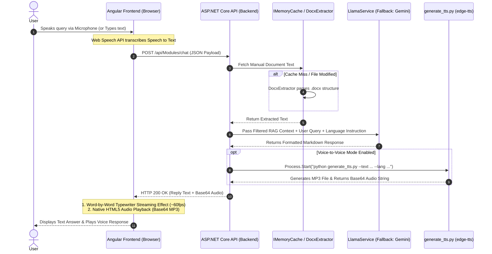

# SMART Maharashtra MIS — User Manual Chatbot (with Voice-to-Voice)

A state-of-the-art, document-aware AI Chatbot Assistant built for the **SMART Maharashtra Integrated MIS Platform** (Department of Agriculture, Government of Maharashtra).

This platform parses official Microsoft Word (        `.docx`) user manuals for various MIS modules and answers user queries with context-aware, highly specific procedures and steps. It features a complete **Voice-to-Voice** interface, allowing users to speak queries directly and hear natural neural audio responses read aloud in **English, Marathi, and Hindi**.

---

## 🏗️ Architecture Overview

The system is built on a high-performance two-tier architecture backed by a Python speech synthesis engine:

```
                                
                                                 |
                                                 |  HTTP REST API (JSON & Base64 Audio)
                                                 v
                                  +-----------------------------+
                                  |    ASP.NET Core Web API     |
                                  |       (Port: 5038)          |
                                  +-------+--------------+------+
                                          |              |
                    +---------------------+              +----------------------+
                    | Spawns Process                     | OpenXml Parser & RAG |
                    v                                    v
        +-----------------------+              +-------------------+
        |    generate_tts.py    |              |  Local Word (.docx)|
        |  (edge-tts Python)    |              |  User Manuals     |
        +-----------+-----------+              +---------+---------+
                    |                                    |
                    v                                    v
     +-----------------------------+          +--------------------+
     | Microsoft Edge Neural Voices|          | Primary LLM:       |
     | (Neerja / Aarohi / Swara)   |          | Llama-3.2-1B       |
     +-----------------------------+          +---------+----------+
                                                        | Failover
                                                        v
                                              +--------------------+
                                              | Fallback LLM:      |
                                              | Gemini 2.5 Flash   |
                                              +--------------------+
```

---

## 🛠️ Tech Stack, Libraries & Tools Used

### **1. Backend (.NET 9.0 Web API)**

- **Framework**: ASP.NET Core Web API (.NET 9.0)
- **Libraries**:
  - `DocumentFormat.OpenXml` (v3.5.1): Parses structural content (paragraphs, headings, tables) from Word (`.docx`) manuals.
  - `Microsoft.Extensions.Caching.Memory` (`IMemoryCache`): In-memory caching for extracted document content to guarantee fast response times.
  - `System.Net.Http.HttpClient`: Asynchronous HTTP client for communicating with external LLM APIs.
  - `System.Diagnostics.Process`: Invokes Python execution contexts for Text-to-Speech audio generation.
  - `Microsoft.AspNetCore.OpenApi` (v10.0.2): OpenAPI metadata and documentation.

### **2. Frontend (Angular 14.2.8 Client App)**

- **Framework**: Angular 14.2.8 SPA (Single Page Application)
- **Libraries & Modules**:
  - `@angular/core`, `@angular/common`, `@angular/forms`, `@angular/router`: Angular core modules.
  - `@angular/common/http` (`HttpClient`): Communicates with backend REST API endpoints.
  - `rxjs`: Reactive Extensions for async stream handling.
  - `zone.js` & `tslib`: Standard Angular polyfills and TypeScript runtime helpers.
- **Browser Web APIs**:
  - **Web Speech API (`SpeechRecognition`)**: Native Speech-to-Text (STT) transcribing user speech into text.
  - **HTML5 Audio API (`HTMLAudioElement`)**: Decodes and streams Base64-encoded MP3 audio responses natively.
  - `localStorage`: Persists API keys, language choices, and user preferences.

### **3. Speech Processing & Python Layer**

- **Library**: `edge-tts` (v6.1.9+)
- **Voices Utilized**:
  - English: `en-IN-NeerjaNeural` (Indian English)
  - Marathi: `mr-IN-AarohiNeural` (Marathi Devanagari)
  - Hindi: `hi-IN-SwaraNeural` (Hindi Devanagari)

### **4. AI / LLM APIs & Models Used**

- **Primary Model**: `meta-llama/Llama-3.2-1B-Instruct` via Hugging Face Router API (`https://router.huggingface.co/hf-inference/v1/chat/completions`).
- **Fallback Model**: `gemini-2.5-flash` via Google Generative Language API (`https://generativelanguage.googleapis.com/v1beta/models/gemini-2.5-flash:generateContent`).

### **5. Developer Tools & Runners**

- **Node.js**: Asynchronous process orchestration script (`start.js`).
- **Angular CLI (v14.2.8)**: Building and serving frontend assets.
- **.NET 9 SDK**: Compiling and running the C# Web API backend.
- **Python 3.10+**: Runtime environment for `edge-tts`.

---

## 📁 Detailed Project Structure

```
new_smart chatbot_final/
│
├── README.md                       # Project master documentation
├── start.js                        # Node.js master script to spawn backend & frontend concurrently
├── run.bat                         # Windows batch script launcher
├── requirements.txt                # Python dependencies (edge-tts)
│
├── backend/                        # ASP.NET Core 9 Web API Project
│   ├── Controllers/
│   │   └── ModulesController.cs    # REST Controller (/api/Modules & /api/Modules/chat)
│   ├── Models/
│   │   └── Models.cs               # Data models (ChatRequest, ChatResponse, ModuleConfig, ChatMessage)
│   ├── Services/
│   │   ├── DocxExtractor.cs        # OpenXml Word (.docx) document parser
│   │   ├── LlamaService.cs         # Llama-3.2-1B LLM provider with keyword RAG context scoring
│   │   └── GeminiService.cs        # Gemini 2.5 Flash LLM provider (automatic failover)
│   ├── generate_tts.py             # Python script for generating edge-tts MP3 audio
│   ├── appsettings.json            # Configuration (Manual paths, LLM models, API tokens)
│   ├── appsettings.Development.json # Development settings
│   ├── Program.cs                  # Web API bootstrapping, CORS, HTTP Clients, Memory Cache
│   ├── SmartChatbot.Api.csproj     # .NET Project file & NuGet dependencies
│   └── requirements.txt            # Python dependencies for backend TTS script
│
└── frontend/                       # Angular 14 Client App
    ├── src/
    │   ├── app/
    │   │   ├── app.component.ts    # Primary component logic (Speech STT, TTS player, Chat handler)
    │   │   ├── app.component.html  # Modern UI (Sidebar, Chat log, Suggestion chips, Control bar)
    │   │   ├── app.component.css   # Dark green & gold theme styling
    │   │   └── app.module.ts       # Angular module configuration
    │   ├── assets/                 # Branding images and icons
    │   ├── environments/
    │   │   ├── environment.ts      # Development API endpoint configuration
    │   │   └── environment.prod.ts # Production API endpoint configuration (/api)
    │   ├── index.html              # Entry HTML file
    │   ├── main.ts                 # Angular bootstrap entry point
    │   └── styles.css              # Global styles
    ├── angular.json                # Angular CLI workspace configuration
    ├── package.json                # NPM dependencies and scripts
    └── tsconfig.json               # TypeScript compiler configuration
```

---

## ⚡ How to Run the Project Locally

### **Prerequisites**

1. **.NET 9.0 SDK** installed (`dotnet --version`)
2. **Node.js (v16.x or v18.x)** and `npm` installed (`node -v`)
3. **Python 3.10+** installed and added to PATH (`python --version`)
4. **Edge-TTS Python Library**:
   ```bash
   pip install edge-tts
   ```

---

### **Option 1: One-Click Launch (Recommended)**

Run the Node.js process orchestrator to start both Backend and Frontend in a single step:

```bash
# From project root directory
node start.js
```

*(On Windows, you can also double-click `run.bat`)*

- **Frontend UI**: `http://localhost:4200`
- **Backend Web API**: `http://localhost:5038`

---

### **Option 2: Running Components Separately**

#### **Terminal 1: Start Backend**

```bash
cd backend
dotnet restore
dotnet run
```

#### **Terminal 2: Start Frontend**

```bash
cd frontend
npm install
npm start
```

---

## 🔄 End-to-End Data Flow



### **Flow Breakdown**

1. **User Action**: The user selects a module, toggles **Voice Mode**, and speaks into the microphone.
2. **Speech Recognition (STT)**: The browser's `SpeechRecognition` engine transcribes audio into text in real-time matching the selected language (`en-IN`, `mr-IN`, `hi-IN`).
3. **HTTP Dispatch**: Angular sends a `POST` request to `/api/Modules/chat` with user query, conversation history, selected module, and language preference.
4. **Document Retrieval & RAG**: Backend checks `IMemoryCache` for parsed Word document content. `LlamaService` scores document paragraphs against query keywords to extract top-5 relevant sections (~3,000 chars).
5. **LLM Generation & Failover**: Query is sent to **Meta Llama-3.2-1B**. If HF token is invalid or rate-limited, the system seamlessly fails over to **Google Gemini 2.5 Flash**.
6. **Voice Synthesis (TTS)**: If Voice Mode is active, backend executes `generate_tts.py` as a subprocess. Microsoft Edge Neural Voice generates an MP3 audio file, which is converted into a Base64 string.
7. **Client Rendering**: Angular receives response, streams text response with a word-by-word typewriter animation, and plays Base64 MP3 audio using HTML5 Audio API.

---

## 🚀 Deployment Process (Production Hosting Guide)

> [!IMPORTANT]
> **HTTPS Requirement**: Modern browsers block microphone access (`SpeechRecognition`) over unencrypted HTTP on remote servers. **An SSL certificate (HTTPS) is mandatory for Voice Mode.**

### **Method 1: Ubuntu Linux Server (Nginx + systemd) — Recommended**

#### Step 1: Install Server Dependencies

```bash
sudo apt update && sudo apt install -y dotnet-sdk-9.0 nginx python3 python3-pip
sudo ln -sf /usr/bin/python3 /usr/bin/python
sudo pip3 install edge-tts
```

#### Step 2: Publish Backend & Setup systemd

```bash
# Local build
cd backend && dotnet publish -c Release -o ./publish

# Copy ./publish to server: /var/www/smart-chatbot-backend
sudo chown -R www-data:www-data /var/www/smart-chatbot-backend
```

Create service `/etc/systemd/system/smart-chatbot-api.service`:

```ini
[Unit]
Description=SMART Chatbot API
After=network.target

[Service]
WorkingDirectory=/var/www/smart-chatbot-backend
ExecStart=/usr/bin/dotnet /var/www/smart-chatbot-backend/SmartChatbot.Api.dll
Restart=always
RestartSec=10
User=www-data
Environment=ASPNETCORE_ENVIRONMENT=Production
Environment=URLS=http://localhost:5038

[Install]
WantedBy=multi-user.target
```

Enable service: `sudo systemctl enable --now smart-chatbot-api`

#### Step 3: Build & Host Angular Frontend

```bash
# Local build
cd frontend && npm run build -- --configuration production

# Copy dist files to server: /var/www/smart-chatbot-frontend
```

#### Step 4: Configure Nginx Reverse Proxy & SSL

Create `/etc/nginx/sites-available/smart-chatbot`:

```nginx
server {
    listen 80;
    server_name your-domain.com;

    root /var/www/smart-chatbot-frontend;
    index index.html;

    location / {
        try_files $uri $uri/ /index.html;
    }

    location /api/ {
        proxy_pass http://localhost:5038/api/;
        proxy_http_version 1.1;
        proxy_set_header Host $host;
        proxy_set_header X-Forwarded-For $proxy_add_x_forwarded_for;
        proxy_set_header X-Forwarded-Proto $scheme;
    }
}
```

Enable site & obtain free SSL:

```bash
sudo ln -s /etc/nginx/sites-available/smart-chatbot /etc/nginx/sites-enabled/
sudo systemctl reload nginx
sudo certbot --nginx -d your-domain.com
```

---

### **Method 2: Docker & Docker Compose**

Run the application as isolated containers using Docker:

#### `docker-compose.yml`

```yaml
version: '3.8'

services:
  backend:
    build:
      context: ./backend
      dockerfile: Dockerfile
    ports:
      - "5038:5038"
    restart: always
  
  frontend:
    build:
      context: ./frontend
      dockerfile: Dockerfile
    ports:
      - "80:80"
    depends_on:
      - backend
    restart: always
```

Start containerized environment:

```bash
docker-compose up -d --build
```

## 📜 License & Acknowledgments

- **Organization**: Department of Agriculture, Government of Maharashtra
- **Developer**: SMART MIS Platform Team (Amnex Infotechnologies)
- **AI Models**: Meta Llama 3.2 & Google Gemini 2.5 Flash
- **Voice Engine**: Microsoft Edge Neural TTS Engine (`edge-tts`)
